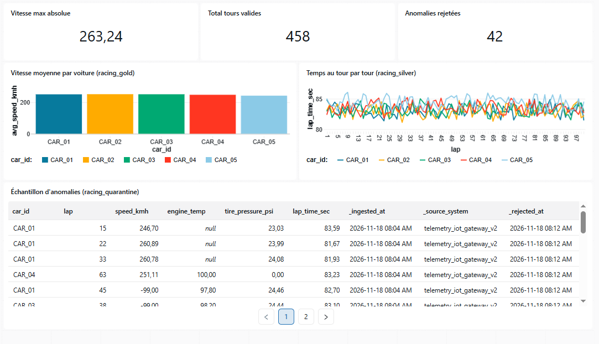

# 🏎️ Real-Time Racing Telemetry Lakehouse (Medallion Architecture)

Pipeline de Data Engineering de bout en bout construit sur **Databricks**, simulant l'ingestion, le nettoyage, la transformation et la visualisation de données de télémétrie IoT pour un championnat automobile.

## 🏗️ Architecture du Projet (Medallion Pattern)
* **Bronze (`racing_bronze`)** : Ingrédients bruts, typage strict des schémas et ajout de métadonnées d'audit (IoT Gateway).
* **Silver (`racing_silver` & `racing_quarantine`)** : Dédoublonnage, application de règles de qualité strictes (gestion des valeurs nulles, capteurs défectueux) et isolation des anomalies en quarantaine. Chargement incrémental via **`MERGE INTO` (Upsert)**.
* **Gold (`racing_gold`)** : Agrégations métiers avancées (meilleurs tours, vitesses moyennes, vitesses maximales par voiture).

## 📊 Dashboard de Contrôle Opérationnel
Le tableau de bord centralise les indicateurs clés de performance (KPIs) et le suivi des tours :

## ⚡ Fonctionnalités Avancées
* **Delta Lake Time Travel** : Capacité de remonter dans l'historique transactionnel pour restaurer des données après une erreur de manipulation (`RESTORE TABLE ... TO VERSION AS OF`).
* **Gestion de Quarantaine** : Traçabilité complète des erreurs capteurs (vitesses négatives, températures manquantes, pressions à zéro).
